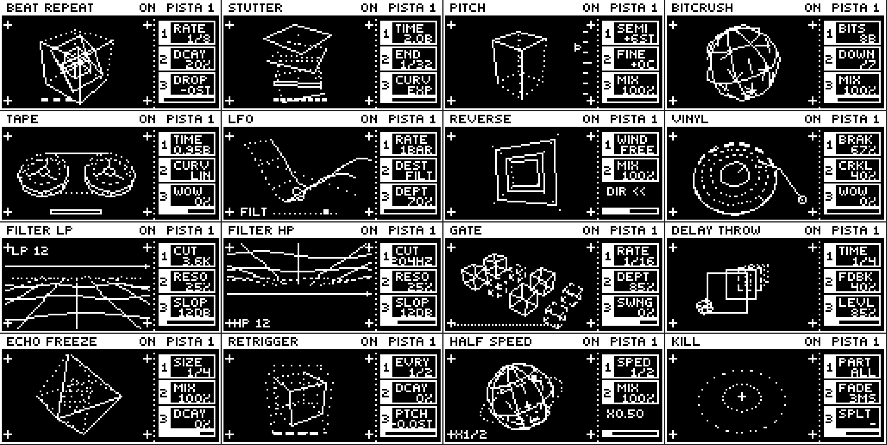

# Looper 606

**Manual interactivo (8 idiomas): https://rogerbacardit.github.io/movy-looper/**

Looper de 6 pistas para directo que se carga **dentro de una pista de Movy** (Schwung `sound_generator`, entrada de audio activada) en la Ableton Move. Los pads graban, reproducen y sobregraban; los knobs son el mezclador o los parámetros de la pista seleccionada; los 16 botones de paso son efectos PERFORM (26 efectos) o el largo del loop.



El motor de audio es **Mark** de Tim Cox (MIT, https://github.com/timncox/schwung-mark), incluido como fork propio en `src/mark_core.c` (modificado para Looper 606, ver `LICENSE-mark`). Las ideas de uso vienen de la Boss RC-505 y de Loopex (solo ideas, ningún código). Diseño y decisiones: `docs/BRIEF.md`.

**Requisito en Movy:** los LED de los pads, la pantalla propia, los botones de paso, Undo, borrar con X, SHIFT nativo y la pedalera necesitan el build `module-leds` de Movy ([PR #38](https://github.com/DimaDake/schwung-movy/pull/38), API genérica para módulos). Sin él, el módulo suena igual pero sin esos extras.

---

# Cómo funciona

## 1. Mapa de pads

4 filas x 8 columnas. Pad 1 = abajo a la izquierda; fila 1 = la de abajo. Todos los gestos actúan al note-on.

| | Col 1 MASTER | Col 2-7: pistas T1-T6 | Col 8 AJUSTES REC |
|---|---|---|---|
| **Fila 4** | SHIFT (toque = PERFORM, mantener = modificador) | Selector de pista (vista PISTA; otra vez = MIX) | Count-in on/off |
| **Fila 3** | ARM (grabar al detectar sonido) | MUTE (sigue girando, vuelve en su sitio) | Rec Action REC>PLAY / REC>DUB |
| **Fila 2** | ALL START/STOP | PLAY/STOP | LEN: libre / 1 / 2 / 4 / 8 / 16 / 32 compases |
| **Fila 1** | STOP ALL (apagado en reposo, amarillo si algo suena) | REC / DUB | Quantize on/off |

Colores: verde = suena, rojo = graba o DUB, naranja parpadeante = ARM, verde parpadeante = lanzamiento pendiente a compás. Las columnas 2-7 usan el color de cada pista (T1 azul, T2 cian, T3 amarillo, T4 lima, T5 magenta claro, T6 naranja); mute = gris. Columna 8 en blanco (brillante = activo o distinto del valor por defecto).

- **REC/DUB (fila 1):** pista vacía graba; segundo toque cierra (PLAY, o DUB si Rec Action = REC>DUB); PLAY pasa a DUB y viceversa; pista parada empieza directamente en DUB.
- **PLAY/STOP (fila 2):** parada pasa a PLAY; sonando o DUB a STOP; grabando cierra y para.
- **Quantize ON:** PLAY en una pista parada espera al siguiente compás de la rejilla (arranca en fase con el loop base). OFF arranca al instante. Con el transporte en pausa el lanzamiento es inmediato.
- **ARM:** un toque activa/desactiva. Con ARM, REC en una pista vacía la deja armada y empieza a grabar cuando la entrada supera el umbral.
- **Count-in:** grabar en pista vacía espera 1 compás (SHIFT + pad: 1 o 2 compases).
- **Undo / Redo:** botón Undo del Move (Shift+Undo = rehacer), un nivel. Deshace overdub, grabación, CLEAR o cambio de largo.
- **Mute y transporte de Movy:** el mute de pista de Movy silencia todo el looper (fundido de 10 ms, cabecera `MUTED`); Stop = STOP ALL recordando qué sonaba, Play = relanza esas pistas.

## 2. Gestos con SHIFT

El **SHIFT del looper** es el pad de arriba de la columna 1. Toque corto (< 300 ms, sin combos) = activa/desactiva PERFORM; mantenido = modificador. Es gris tenue, blanco al mantenerlo y parpadea en blanco con PERFORM activo.

| SHIFT del looper + | Efecto |
|---|---|
| selector de pista (fila 4) | **FX CLR**: apaga los efectos PERFORM de esa pista, FX de pista OFF, reverse off, velocidad x1 y borra su automatización (audio, volumen, pan y mute intactos) |
| pad REC de una pista (fila 1) | Reverse de esa pista (nunca graba) |
| pad MUTE de una pista (fila 3) | SOLO (otra vez = quita el solo y restaura los mutes) |
| Col 8 fila 4 | Count-in 1 / 2 compases |
| Col 8 fila 3 | Umbral de ARM: -54 / -48 / -42 / -36 / -30 dB |
| Col 8 fila 1 | MONITOR on/off |
| paso N (mantenido) | efecto N momentáneo (ver PERFORM) |

El **SHIFT nativo del Move** lo reenvía Movy con `shift_pad_param` (no llega como nota):

| SHIFT nativo + | Efecto |
|---|---|
| selector de pista (fila 4) | FX CLR de esa pista |
| pad MUTE de una pista (fila 3) | SOLO de esa pista |
| Undo | Redo |

## 3. Gestos de borrar (Delete / X del Move)

Movy los reenvía con `delete_pad_param`. El pedal (mantener 2) solo borra el audio.

| Gesto | Efecto |
|---|---|
| X + pad de las filas 2-3 de una pista | CLEAR: borra el audio, la pista conserva sus ajustes (Undo lo devuelve) |
| X + pad REC (fila 1) | Quita solo la última capa de overdub (`UNDO DUB n`); si no hay dub, borra el audio |
| X + selector de pista (fila 4) | `RESET FX n`: FX, pan, volumen 100, velocidad x1, reverse, one-shot y mute a valores de fábrica, efectos PERFORM de esa pista apagados y automatización borrada. El audio y IN/OUT no se tocan |
| SHIFT del looper + X + selector | RESET completo: audio y todos los ajustes (Undo lo devuelve) |
| X + knob K1-K3 de un efecto | Borra la curva de automatización de ese knob |

## 4. Selector de pista y vista PISTA

Tocar el selector (fila 4) de una pista pasa los 8 knobs a esa pista (`knob_capture_param`) y la pantalla muestra una página de parámetros estilo Schwung (`PISTA 3`, estado a la derecha, valor del último knob 1,5 s). Tocar la pista ya seleccionada vuelve a MIX.

| Knob | MIX (nada seleccionado) | Vista PISTA |
|---|---|---|
| K1 | Volumen pista 1 | **IN**: inicio del clip (rejilla 1/16) |
| K2 | Volumen pista 2 | **OUT**: fin/largo (rejilla 1/16; acortar no destruye) |
| K3 | Volumen pista 3 | Volumen de la pista |
| K4 | Volumen pista 4 | Pan |
| K5 | Volumen pista 5 | Tipo de FX: OFF / LPF / HPF / CRUSH / DELAY / PHASER / RING |
| K6 | Volumen pista 6 | Cantidad de FX |
| K7 | Volumen de entrada | Velocidad x1/4, x1/2, x3/4, x1, x1.5, x2, x4 (estilo cinta; sin overdub si no es x1) |
| K8 | Master | Reverse off/on |

- Al girar IN/OUT la onda hace **zoom** (2 compases centrados en el punto; 1/2 compás con Loop + knob fino) y vuelve sola 2,5 s después.
- **Loop + knob N** (mantener el botón Loop del Move): mueve el inicio del clip de la pista N sin destruir audio (1/16 por paso; con Shift 1/64). No funciona grabando ni con la pista vacía.
- **16 botones de paso** (fuera de PERFORM): con clip, el paso N pone el loop a N compases (no destructivo; más largo = se repite hasta llenarlo, hasta lo que cabe en la pista); con la pista vacía fija el largo de las próximas grabaciones. Los LEDs muestran el largo.
- Otros ajustes: pantalla Setup con umbral de ARM, quantize, largo fijo, Rec Action, count-in, BPM manual (0 = automático), monitor, arm; página Status de solo lectura (Empty / Armed / Rec / Play / Dub / Stop / Mute).

## 5. Modo PERFORM

Un toque corto de SHIFT activa PERFORM (`PERFORM ON`); otro lo desactiva. Con SHIFT mantenido se ve la página PERFORM sin activar el modo. Flujo: toca SHIFT, elige objetivo con el selector (una pista, o MIX), toca un paso.

- **Toque (< 300 ms):** enciende el efecto y se queda encendido; otro toque en el mismo paso lo apaga.
- **Mantener (> 300 ms):** momentáneo, se apaga al soltar.
- **Hasta 6 efectos a la vez** (`PERFORM: MAX 6`); el último pulsado es el **actual** y sus K1-K3 son los knobs (K1-K3 de cualquier efecto llegan con `knob_delta`, también en MIX).
- `<` y `>` cambian de página de efectos (`FX PAGE n/2`) y muestran la rejilla 4x4; girar un knob vuelve a la escena del efecto. En PERFORM los knobs nunca tocan IN/OUT ni la velocidad.
- Al salir del modo, los efectos encendidos siguen sonando (parpadean en los LED) y cada uno queda en su pista.
- LED de paso por familia: azul repetición, naranja cinta/tiempo, violeta tono/filtro, cian ritmo, verde azulado espacio, amarillo KILL, lima modulación.
- Los efectos solo actúan sobre la **salida** (anillo de ~6 s por pista y otro para la mezcla): nunca escriben en los buffers del loop, y al soltar la mezcla es idéntica bit a bit (excepto la cola de DELAY THROW).
- Cadena fija: TEMPO, tiempo/repetición, tono/cinta, RING MOD, filtros, COMB/CHORUS/FLANGER/PHASER, DRIVE, BITCRUSH, GATE, SIDECHAIN, AUTOPAN/TREMOLO, KILL, DELAY/FREEZE.
- CPU medida (host, -O2, un carril): 6 efectos pesados ~29 us por bloque de 128 frames (presupuesto 2900 us).

## 6. Los 26 efectos

Los knobs por pasos (opciones) avanzan una posición cada 3-10 clics según el número de opciones; los continuos aceleran solo en giros muy rápidos.

**Página 1** (pasos 1-16)

| Paso | Efecto | K1 | K2 | K3 |
|---|---|---|---|---|
| 1 | BEAT REPEAT | tasa 1/4 1/8 1/16 1/32 1/8T 1/16T | decay por repetición | bajada de tono por repetición (0-12 st) |
| 2 | STUTTER | tiempo 1-4 pulsos | tasa final 1/16 1/32 1/64 | curva de aceleración |
| 3 | PITCH | -12..+12 semitonos | afinación fina ±50 cents | mezcla seco/mojado |
| 4 | BITCRUSH | bits 16..2 | submuestreo 1..32 | mezcla |
| 5 | TAPE (stop + start) | tiempo 1/4..2 pulsos | curva | wow |
| 6 | LFO | tasa (14 sincronizadas + 11 libres en Hz) | destino FILT / VOL / PAN / PTCH | profundidad |
| 7 | REVERSE | ventana 1/4, 1/2, 1 compás, libre | mezcla | - |
| 8 | VINYL | freno | crujido | wow |
| 9 | FILTER LP | cutoff 30 Hz..18 kHz | resonancia | pendiente 12 / 24 dB |
| 10 | FILTER HP | cutoff | resonancia | pendiente 12 / 24 dB |
| 11 | GATE | tasa | profundidad | swing |
| 12 | DELAY THROW | tiempo 1/8 1/8. 1/4 1/4. 1/2 | feedback 0-88 % | nivel del eco |
| 13 | ECHO FREEZE | tamaño 1/16..1 pulso | mezcla | decay (0 % = infinito) |
| 14 | RETRIGGER | cada 1/4, 1/2, 1 compás | bajada de volumen | bajada de tono (0-4 st) |
| 15 | HALF SPEED | 1/2 o 1/4 | mezcla | - |
| 16 | KILL | parte ALL / LOW / HIGH | fundido 2-500 ms | corte LOW/HIGH 60 Hz..12 kHz |

**Página 2** (`>` en PERFORM)

| Paso | Efecto | K1 | K2 | K3 |
|---|---|---|---|---|
| 1 | SIDECHAIN | tasa 1/4 1/8 1/16 1/32 1/8T 1/16T | profundidad | curva de recuperación |
| 2 | DRIVE | ganancia | tono | mezcla |
| 3 | RING MOD | frecuencia 20 Hz..4 kHz | modo FREE / NOTE | mezcla |
| 4 | FLANGER | tasa | profundidad | feedback |
| 5 | PHASER (4 etapas) | tasa | profundidad | feedback |
| 6 | CHORUS | tasa | profundidad | mezcla |
| 7 | AUTOPAN | tasa 1/16..4 compases | profundidad | forma SIN / TRI / SQR |
| 8 | TREMOLO | tasa 1/16..4 compases | profundidad | forma SIN / TRI / SQR |
| 9 | COMB | tono 55 Hz..1.7 kHz | feedback | mezcla |
| 10 | **TEMPO** | BPM objetivo del clip (50-200 % del proyecto, 1 BPM por clic, 0.1 con REC) | glide: salto, 1/2 pulso, 1, 2 pulsos, 1, 2 compases | tamaño de grano 15-90 ms |

**TEMPO** cambia el tempo de *ese clip* sin cambiar el tono (time-stretch con dos granos Hann). Solo en pistas: con MIX avisa `TEMPO: PICK A TRACK`. Al apagarlo vuelve a x1 con el mismo glide y se resincroniza en el siguiente pulso.

## 7. Automatización de knobs (mantener REC + girar)

En PERFORM con un efecto encendido: **mantén el pad REC** (fila 1) de una pista que suena y gira K1-K3. Lo que gires se graba a lo largo de todo el loop de esa pista (`AUTO-REC n`, 256 pasos, interpolación lineal, de IN a OUT a cualquier velocidad y con reverse). Al soltar, la curva suena en bucle. Un toque corto de REC sin girar nada sigue siendo el REC normal. Se guarda con el Set. Los knobs por pasos graban posiciones exactas, sin interpolar. Borrar: X + knob, o X + selector (toda la automatización de la pista).

## 8. Columna 8: ajustes de grabación

| Pad | Función |
|---|---|
| Fila 4 | **Count-in** on/off (SHIFT + pad: 1 / 2 compases) |
| Fila 3 | **Rec Action**: REC>PLAY o REC>DUB (SHIFT + pad: umbral de ARM) |
| Fila 2 | **LEN** (largo fijo): libre / 1 / 2 / 4 / 8 / 16 / 32 compases. La grabación se cierra sola. Si el largo no cabe en el buffer (120 s por pista por defecto, según el tempo) se recorta al máximo (`LEN 32 > MAX 16`) y la siguiente pulsación vuelve a libre |
| Fila 1 | **Quantize** on/off (SHIFT + pad: MONITOR). Quantize nunca bloquea una grabación |

LEN es el mismo ajuste que `Fixed Length` de Setup (hasta 32) y que los botones de paso (1-16).

## 9. Knobs y páginas

- **Mezclador / MIX:** K1-K6 volúmenes, K7 entrada, K8 master.
- **Vista PISTA:** ver sección 4. **Efecto PERFORM actual:** K1-K3 (más los cuatro destinos de LFO, etc.).
- **Pantalla propia:** el módulo declara `screen_param` (framebuffer 128x64 de 1 bit) y Movy lo dibuja en lugar de la onda: página PERFORM, escenas 3D de cada efecto, rejilla.
- **Onda:** en MIX, solo la región que suena; en PISTA, todo el buffer con marcas IN/OUT. El cursor sigue la posición real (reverse, velocidad, inicio).
- **Persistencia:** los loops sobreviven a cerrar Movy y apagar la Move. Se guardan por Set en `/data/UserData/schwung/looper-loops/<id>/` (WAV + `loops.json`) por un hilo propio, nunca en el hilo de audio. También vuelven largo fijo, velocidad, mute, count-in, umbral, volumen de entrada y automatización.

## 10. Pedalera Blackstar Live Logic

Pedalera en el hub USB-A de la Move, en modo **CUSTOM**. Movy reenvía los 6 interruptores con `pedal_param`; siempre actúa sobre la pista seleccionada (aviso `TRACK n`).

| Interruptor | Toque | Mantener 1 s |
|---|---|---|
| 1 | REC/DUB/PLAY (como el pad de fila 1) | - |
| 2 | PLAY/STOP (como el pad de fila 2) | CLEAR de la pista (se puede deshacer) |
| 3 | pista anterior (da la vuelta) | ARM on/off |
| 4 | pista siguiente (da la vuelta) | - |
| 5 | UNDO | - |
| 6 | STOP ALL si algo suena, si no ALL START | - |

---

# Cambios recientes

- **v0.15.1:** arranque de pistas alineado en fase y a compás con quantize ON; lanzamiento inmediato con el transporte en pausa; pads PLAY/REC parpadean en verde mientras esperan; test de latencia.
- **v0.15.0:** efecto **TEMPO** (time-stretch del clip, K1 = BPM objetivo), página 2 paso 10 (26 efectos).
- **v0.14.6:** LEN cicla hasta 16 y 32 compases (recortado a lo que cabe); STOP ALL y ALL START/STOP intercambiados; STOP ALL en amarillo si algo suena.
- **v0.14.x:** 25 efectos y página 2 (SIDECHAIN, DRIVE, RING MOD, FLANGER, PHASER, CHORUS, AUTOPAN, TREMOLO, COMB); hasta 6 efectos a la vez; automatización de 256 pasos; knobs por pasos con tacto propio; X + selector = `RESET FX`; SHIFT nativo + selector = FX CLR y + MUTE = SOLO; pista 4 en lima.
- **v0.13.0:** automatización con REC mantenido; SHIFT nativo del Move (`shift_pad_param`).
- **v0.12.0 y anteriores:** DUB en rojo, paginas de efectos con `<` `>`, modo PERFORM de un botón, escenas 3D, TAPE y LFO, selector de pista y vista PISTA, persistencia de loops, pedalera, mute y transporte de Movy.

Historial completo y notas de diseño: `docs/BRIEF.md`.

---

# Instalación

Necesitas Movy con el build `module-leds` para el LED y los gestos de Movy (ver arriba).

1. **Compila** el paquete para la Move (hace falta `aarch64-linux-gnu-gcc` o Docker en marcha):
   ```
   make test-synth     # tests en el Mac (585 comprobaciones)
   make arm-synth      # -> build/looper-606-module.tar.gz
   ```
   Segundos máximos por pista: `make arm-synth MARK_SECONDS=60` (por defecto 120; 6 pistas x 120 s + undo ~ 148 MB; si calloc falla el motor baja solo a 90/60/45/30...).
2. **Descomprime:** `tar -xzf build/looper-606-module.tar.gz` (crea `looper-606/` con `dsp.so` y `module.json`). También puedes bajar el `.tar.gz` de la última [Release](https://github.com/rogerbacardit/movy-looper/releases).
3. **Copia a la Move:** `scp -r looper-606 ableton@move.local:/data/UserData/schwung/modules/sound_generators/`
4. **Propietario:** en la Move, `chown -R ableton:users /data/UserData/schwung/modules/sound_generators/looper-606`
5. **Reinicia Schwung** (o vuelve a escanear módulos). En Movy, carga **Looper 606** como sonido de una pista.

Notas técnicas: el motor soporta `MARK_TRACKS=6` de forma nativa; los cambios respecto a Mark están marcados `L606` en `src/mark_core.c`. Volcar fotogramas de la pantalla: `make perform-frames`.

**Comprobaciones en el dispositivo:** el log dice una vez `bpm source = ...` y `input source = ...` / `input peak after 1 s = N` (si pone SILENT, el host no entrega audio de entrada: ver `docs/BRIEF.md`). Movy duerme una pista cuya salida lleva ~1 s en silencio, por eso el módulo suma un dither de ±6 LSB (-74 dBFS) mientras haya pistas en uso.
